# HumanoidStandup-v5: from lying flat to standing still

Single-file implementations of the methods that have published results on Gymnasium's
`HumanoidStandup-v5`, sharing one env setup and one set of "is it standing?" metrics. The best
published method (BAC) stands bent at the hips. We then go further with CrossQ plus two reward
extensions of our own: a **posture** bonus for an upright spine and a **stillness** penalty for
wandering and twitching once standing.

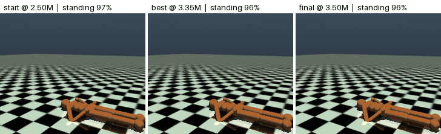

## Results

All numbers are from the best checkpoint of each run (single seed), evaluated on separate
episodes. *Return* is the stock benchmark reward, even for runs trained with extra reward terms.

| Method | Steps | Return | Mean torso height | Time standing | Stands up | Spine lean |
|---|---|---|---|---|---|---|
| PPO | 10M | 162k | 0.49 m | 11% | 0/5 (lunges up, falls) | |
| RPO + symmetry | 1.5M (crashed) | 157k | 0.47 m | 0% | 0/3 | |
| TD3 | 2M | 152k | 0.45 m | 0% | 0/5 (sits) | |
| SAC | 2M | 252k | 0.75 m | 7% | 0/3 (high crouch) | |
| CrossQ | 1M | 331k | 0.99 m | 59% | 2/5 | 13° |
| BAC | 2.5M | 353k | 1.06 m | 96% | 10/10 | 30° |
| CrossQ, continued | 2.5M | **404k** | 1.21 m | 97% | 10/10 | 8.6° |
| **CrossQ + posture** | 2.5M | 402k | 1.20 m | 97% | 10/10 | **1.0°** |
| **CrossQ + posture + stillness** | 3.5M | 400k | 1.20 m | 96% | 10/10 | 1.4° |

For reference, the BAC paper reports ~280k at 2.5M and ~360k at 5M steps; SAC and PPO are
usually reported plateauing around 130–170k.

Motion once standing (steps 300–1000), measured with `python stillness.py measure`:

| | BAC | CrossQ + posture | CrossQ + posture + stillness |
|---|---|---|---|
| horizontal torso speed | – | 0.32 m/s | **0.05 m/s** |
| joint speed (RMS) | 2.61 rad/s | 1.32 rad/s | **0.16 rad/s** |
| action change per step | 0.16 | 0.20 | **0.03** |
| torso height wobble | 3.7 cm | 0.5 cm | **< 0.1 cm** |

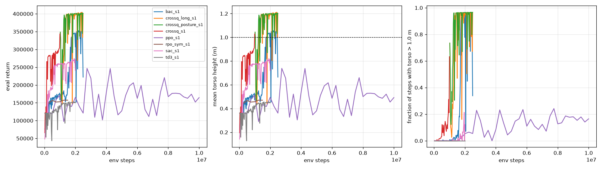

### How to read the panels below

Each part shows one episode (seed 0, played in real time) from three checkpoints:
**start** (uniform-random actions, which is what every from-scratch run does at step 0, or the
checkpoint a continuation run started from), **best** (the checkpoint with the highest eval
return) and **final** (the last checkpoint). Only best and final checkpoints were saved, so the
curve next to each GIF shows what happened in between; the GIF's checkpoints are marked on it.
The caption gives the fraction of that episode spent standing (torso above 1 m).

### PPO

Never learns to hold a stand. The final policy lunges up and falls back; "best" by a 3-episode
eval is a sitting policy, a reminder that the eval is noisy.

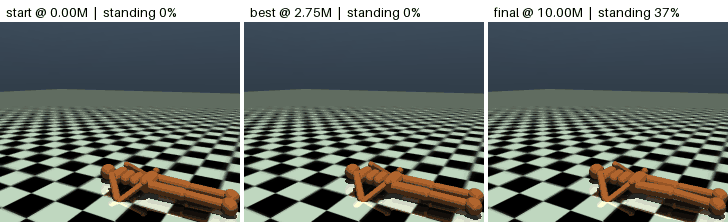
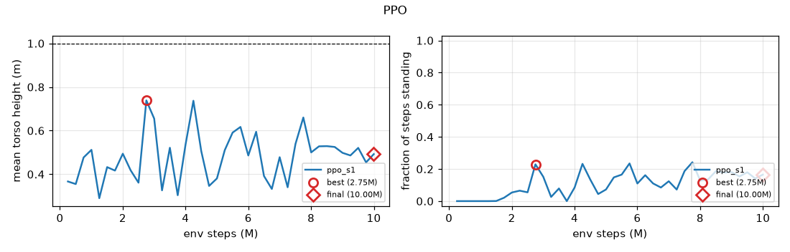

### RPO + symmetry loss

Sits upright at ~0.47 m. The run crashed at 1.5M steps (a CUDA driver error), so it was not
trained to the planned 10M.

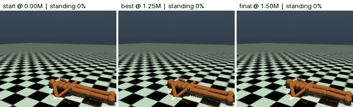
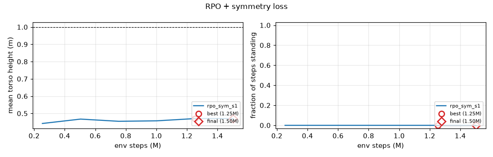

### SAC

Learns a high crouch (~0.8 m) and occasionally pops up above 1 m, but never holds it.


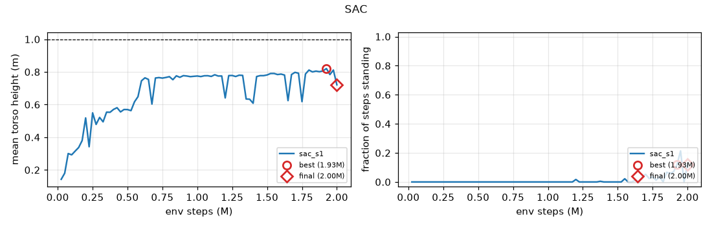

### TD3

Stuck sitting at 0.45 m for the second half of training.

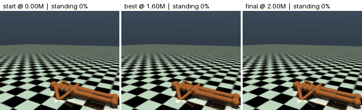
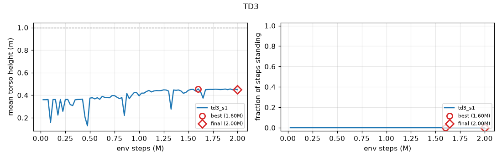

### BAC

The only published method that stands: it breaks through between 1.6M and 1.75M steps. It
stands bent ~30° at the spine with hips flexed ~55°, a low and stable but hunched stance.


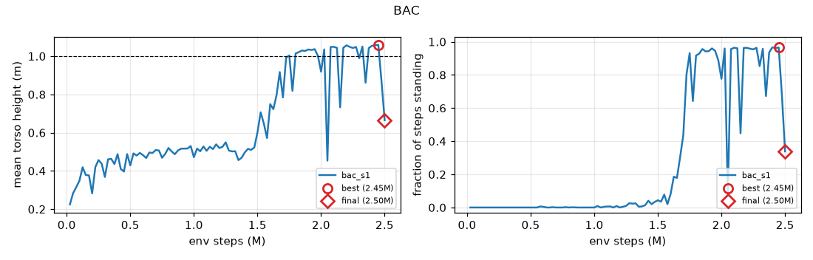

### CrossQ (1M steps)

Nearly matches BAC with less than half the steps and a straighter stance, but holds it only
about half the time.

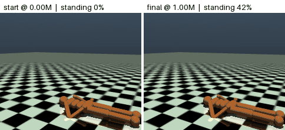
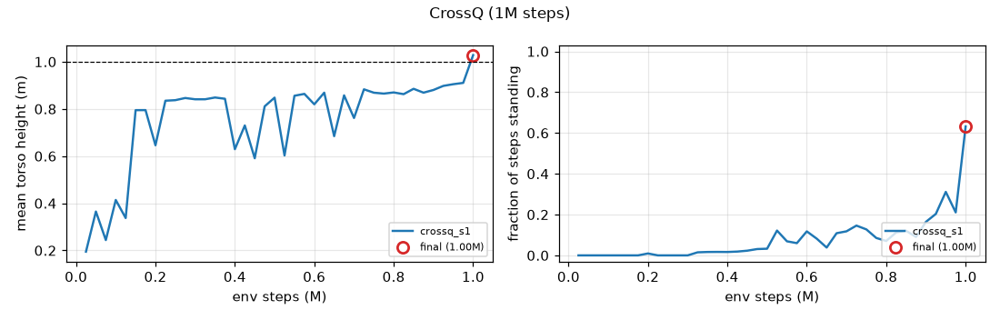

### CrossQ continued to 2.5M (no posture reward)

The control for the posture experiment. With more steps CrossQ stands reliably, straight-kneed,
at 1.21 m, but leans 5–20° and drifts around. (The dip right after 1M is the replay buffer being
refilled from empty after the restart.)


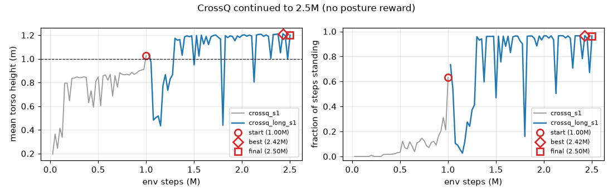

### CrossQ + posture reward

Same continuation, plus a bonus for keeping the pelvis→head line vertical. Same return as the
control, but the lean stays at 1–2° instead of 5–20°.


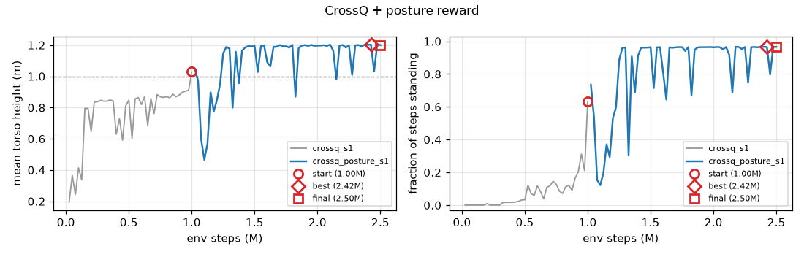

### CrossQ + posture + stillness

Continued from the posture run with a penalty on drifting, joint speed and action changes while
standing. It now stands up and then holds still: joint speed drops 8×, with no loss of return.


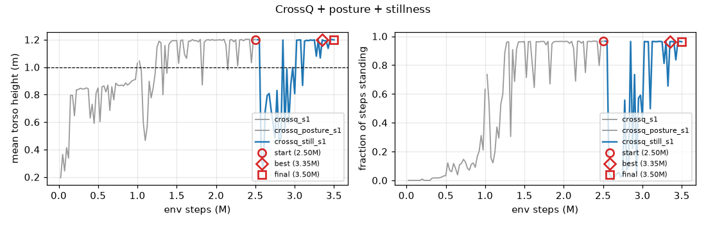

## Files

| File | What it is |
|---|---|
| `common.py` | env factory (actions rescaled to [-1, 1], posture readout/bonus), running mean/std, posture metrics, logger, left/right mirror map |
| `ppo.py` | PPO (CleanRL-style), `--rpo-alpha 0.5` for RPO, `--sym-coef 0.02` for the symmetric-action loss |
| `offpolicy.py` | `--algo sac \| td3 \| crossq \| bac`; `--posture-coef` for the posture bonus, `--init-from` to continue another run |
| `stillness.py` | stillness penalty: trains via `offpolicy.py`, and `measure` reports motion while standing |
| `evaluate.py` | runs a checkpoint for N episodes, reports standing metrics, saves height plot and video |
| `plot_runs.py` | compares all runs in `runs/` (`runs/comparison.png`) |
| `run_queue.py` | runs the jobs a few at a time, within the machine's memory |
| `make_readme_media.py` | renders the GIFs and curves in `media/` |

Each run writes to `runs/<name>/`: `train.csv`, `eval.csv`, `losses.csv`, `config.json`,
TensorBoard events, `best.pt` and `last.pt`. Checkpoints and TensorBoard files are not in the
repository (the CrossQ checkpoints are 115 MB each).

## Setup

The venv lives outside OneDrive so the 3 GB of PyTorch isn't synced:

```bash
C:\Users\hp\.venvs\humanoid\Scripts\activate
pip install -r requirements.txt
```

## Running

`python run_queue.py --max-parallel 1` runs the benchmark in priority order
(BAC → SAC → PPO → CrossQ → TD3 → RPO+sym), then the posture experiment. It only starts a job when
at least 6 GB of commit is free, because each CUDA process takes about 4.4 GB on Windows.
Finished jobs get a `runs/<name>/done` marker and are skipped on restart.

Individual runs:

```bash
python ppo.py --total-steps 10000000                 # PPO baseline (16 parallel envs)
python ppo.py --rpo-alpha 0.5 --sym-coef 0.02        # RPO + symmetric-action loss
python offpolicy.py --algo sac --total-steps 2000000
python offpolicy.py --algo td3 --total-steps 2000000
python offpolicy.py --algo crossq --total-steps 1000000
python offpolicy.py --algo bac --total-steps 2500000

# continue CrossQ with the posture bonus, then add the stillness penalty
python offpolicy.py --algo crossq --total-steps 2500000 --init-from runs/crossq_s1/last.pt --posture-coef 150 --run-name crossq_posture_s1
python stillness.py --algo crossq --total-steps 3500000 --init-from runs/crossq_posture_s1/last.pt --posture-coef 150 --run-name crossq_still_s1

tensorboard --logdir runs
python plot_runs.py
python evaluate.py runs/crossq_still_s1/best.pt --episodes 10 --video
python stillness.py measure runs/crossq_still_s1/best.pt
python make_readme_media.py
```

## How to read the numbers

The return is almost entirely `torso_z / model.opt.timestep` summed over 1000 steps, so it is a
height readout. `model.opt.timestep` is 0.003, so the per-step height reward is `torso_z / 0.003`.
Lying flat (z ≈ 0.1) gives about 35k per episode, which is also what a random policy gets. Sitting
up (z ≈ 0.4) gives about 125k, and standing fully upright (z ≈ 1.23 m, knees straight, spine
vertical) gives about 400k.

- **mean_height**: average torso height (m) over the episode.
- **final_height**: average over the last 100 steps, which tells you where it ended up.
- **frac_standing**: fraction of steps with torso above 1.0 m (the criterion used in Gymnasium PR #1767).
- **posture**: final height > 1.0 m is "standing", 0.3–1.0 m is "sitting/kneeling", below that is "lying".
- **final_tilt**: angle of the pelvis→head line from vertical (degrees), last 100 steps.

## Per-method design

**Shared across all methods**
- **Actions:** 17 torques. Policies output in [-1, 1] and `RescaleAction` maps that to the env's ±0.4.
- **State:** the raw 348-dim v5 observation, normalized with running mean and std. Contact forces
  and inertia terms have very different scales.
- **Reward:** the env reward, unchanged (except the posture and stillness runs below).
- **Discount:** γ = 0.99.

**PPO.** Separate actor and critic networks, each a 256-256 tanh MLP with orthogonal init. The
log-std is a learned free parameter, not conditioned on state.
- Reward is normalized by the std of the discounted return.
- At the 1000-step truncation, V(s_final) is bootstrapped. The env never terminates, so treating
  truncation as death would teach a time-dependent value the network can't observe.
- GAE λ = 0.95, entropy coefficient 0, advantages recomputed every epoch.
- 16 envs × 256 steps per update, 10 epochs, 8 minibatches.

**RPO.** The same as PPO, except that during the update the Gaussian mean is shifted by
U(-0.5, 0.5). This keeps exploration from collapsing.

**Symmetric-action loss.** Adds `coef · ||μ_left − s·μ_right||²`. The mirror signs `s` are
computed from the MuJoCo joint axes reflected through the sagittal plane. It targets the
"pushes up with one arm" failure.

**SAC.** Tanh-Gaussian actor with state-dependent std, twin Q critics, Polyak target networks
(τ = 0.005) and auto-tuned α with a target entropy of −17.
- 256-256 ReLU networks, batch size 256, learning rate 3e-4.
- 10k uniform-random warmup steps.
- Reward scaled by 0.01, which only changes the numerics.

**TD3.** Deterministic actor with Gaussian exploration noise of 0.1.
- Target-policy smoothing: noise 0.2, clipped at 0.5.
- Actor and target networks are updated every 2nd step.

**CrossQ.** No target networks.
- The critic has Batch Renormalization on its input and hidden layers, and is wide (2048-2048).
- (s,a) and (s',a') are passed through the critic in one batch, so the BN statistics match.
- Adam with β1 = 0.5 and learning rate 1e-3.
- Actor updated every 3rd step, one update per environment step (UTD 1).

**BAC (the BEE operator).** Builds on SAC by adding V(s), trained by expectile regression
(τ = 0.7) on target-Q of *buffer* actions. That makes V an in-sample estimate of the best action
the agent has already tried.
- The critic target is `r + γ[λ·V(s') + (1−λ)·(min Q'(s',a') − α log π)]` with λ = 0.5.
- This keeps the value of "lucky" partial stand-ups from being washed out by the current
  (worse) policy, which is why BAC gets past the kneeling plateau that SAC gets stuck on.
- 512-unit networks, batch size 512.

**Posture bonus (ours).** `coef · gate · (1 − tilt / 90°)`, where tilt is the angle of the
pelvis→head line from vertical (forward and sideways lean alike) and `gate` ramps from 0 at
sitting height (0.3 m) to 1 at standing height (1.0 m), so sitting up straight earns little.
With `coef = 150`, going from a 30° lean to vertical is worth about as much as 15 cm of torso height.

**Stillness penalty (ours).** Only while the torso is above 0.9–1.0 m, so getting up is free:
`50 · |torso xy speed| + 10 · mean(joint speed²) + 200 · mean((a_t − a_{t−1})²)`. On the posture
policy this costs ~57 per step (about 14% of the height reward): enough that standing still pays,
never enough to make sitting down worthwhile.

**Continuing a run.** `--init-from` loads another run's weights, optimizer state and observation
statistics. The replay buffer is not checkpointed, so it is refilled with the loaded policy for
50k steps before updates restart; expect a temporary dip in performance right after.
